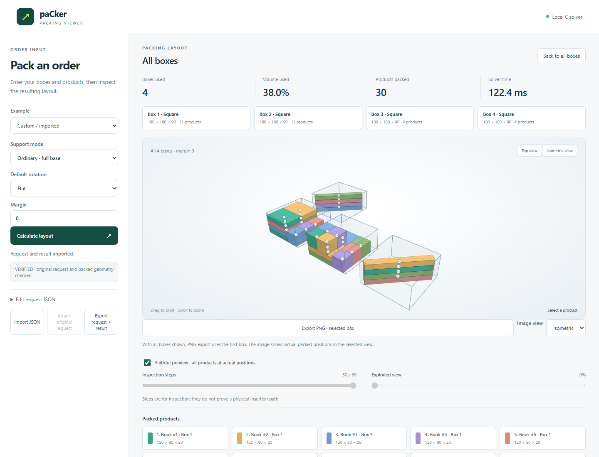

<div align="center">


# paCker

**Fast 3D box packing in C.** Give it your box types and products; get back which boxes to use and
exactly where every product goes.

**[Try it online →](https://davidewastaken.github.io/paCker/)** describe an order and watch it being packed in 3D.



</div>

- **Fast.** A typical order packs in a few milliseconds. A single-threaded C11 engine with no dependencies.
- **Packs tight.** Multi-start search, local moves across boxes and ruin-and-recreate inside each box.
  It can prove when a layout uses the minimum number of boxes.
- **Stable by default.** Every product sits on the floor or has its centre over what it rests on,
  so nothing tips over. You can ask for full base support, or allow overhangs when you use fillers.
- **Real-world constraints.** Box stock, weight limits, box cost, per-product rotation rules, diagonal
  placement and spacing.
- **Use it from anything.** A C library, a JSON CLI, PHP and Python facades, an MCP server for AI agents
  and a 3D viewer.

## Install

```sh
pip install packer3d                       # Python 3.10+
composer require davidewastaken/packer     # PHP 8.1+
```

Both packages bundle the engine for Windows x64 and Linux x64, so no compiler is needed. On other
platforms, or for the C library and the CLI, build from source as below.

## Quick start

Build the engine. On Windows, `./setup.ps1` downloads a pinned Zig compiler and builds everything.
On Linux or macOS, with any C11 compiler:

```sh
sh build.sh
```

Then describe an order:

```json
{
  "boxes": [
    {"id": "small", "width": 300, "length": 200, "height": 150, "max_weight": 5000},
    {"id": "large", "width": 600, "length": 400, "height": 300, "max_weight": 20000, "quantity": 2}
  ],
  "items": [
    {"id": "book", "width": 240, "length": 170, "height": 30, "weight": 400, "quantity": 6},
    {"id": "mug",  "width": 120, "length": 120, "height": 100, "weight": 350, "rotation": "any"}
  ]
}
```

```sh
./build/packer order.json
```

You get every box used, the position and orientation of each product, anything that did not fit, and
search statistics. Units are yours: millimetres and grams in the examples. On Windows the binary is
`build/packer.exe`.

## Use it from your language

**Python** (3.10+, standard library only)

```python
from packer3d import Packer          # pip install packer3d

packer = Packer()
packer.add_box(id="carton", width=180, length=180, height=30)
packer.add_item(id="bar", width=220, length=30, height=20, quantity=3)
result = packer.pack()
```

**PHP** (8.1+)

```php
require 'vendor/autoload.php';       // composer require davidewastaken/packer

$packer = new \paCker\Packer();
$packer->addBox(['id' => 'carton', 'width' => 180, 'length' => 180, 'height' => 30]);
$packer->addItem(['id' => 'bar', 'width' => 220, 'length' => 30, 'height' => 20], 3);
$result = $packer->pack();
```

**C / C++.** Include [`oblique.h`](include/oblique.h), link `liboblique`, and call `op_pack()`.
There is no JSON layer and no child process. See [examples/ordinary.c](examples/ordinary.c).

From a source checkout, `require 'php/src/Packer.php'` and `python/` on `sys.path` work the same way.
[docs/publishing.md](docs/publishing.md) explains how the packages are built and released.

## Rules and options

| Setting | Meaning |
|---|---|
| `rotation` | `none`, `flat` (keep height, the default) or `any` (any face down) |
| `diagonal` | Also try non-right horizontal angles; `true` by default |
| `support_mode` | `stable` (default: centre over the contacts), `contact` (any overlap, for packing with fillers), `full_base`, or `geometric` (free 3D tilt with `rotation: "free3d"`) |
| `max_weight`, `quantity`, `cost` | Box weight limit, stock (`-1` unlimited) and cost |
| `time_limit_ms` | Search budget, 1000 ms by default |
| `improve` | `true` keeps improving until the budget runs out or the layout is proven optimal |
| `gap` | Horizontal clearance between products and walls |

The objective, in order of priority: fewest unpacked products, lowest box cost, fewest boxes, then
smallest total box volume. Each result reports a `lower_bound` on the box count, and `proven_optimal`
when the layout reaches it.

Limits: 64 box types and 256 products per request. Products are treated as rigid cuboids with their
weight at the centre; the engine does not model load bearing or fragility. See [schema 2](docs/schema2.md) for the geometric output and
the [geometric C API](docs/free3d-c-api.md) for free 3D rotation.

## Viewer and AI agents

```sh
python serve.py
```

Then open <http://127.0.0.1:8765> to pack orders and inspect every box in 3D: orbit, step through the
placements, use the exploded view, or export a PNG. **Hide panel** gives the layout the full width, and
<http://127.0.0.1:8765/?view> opens straight into it, handy for looking at an imported result.

For agents, the local [MCP server](docs/mcp.md) offers four tools: `get_capabilities`, `pack_order`,
`validate_packing` and `render_packing`. Results can include rendered images.

## Tests

```sh
python -m pytest tests
```

The build scripts also run the native C tests. Results are checked by an independent validator that
uses its own geometry and high-precision arithmetic, not the solver's.

## License

MIT. Bundled: [cJSON](third_party/README.md) (MIT) and [Three.js](viewer/vendor/README.md) (MIT).
